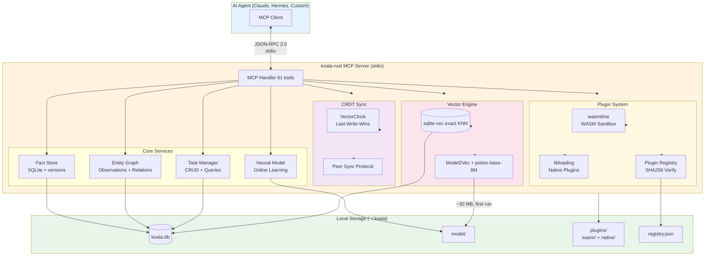

<h1 align="center">🐨 koala-rust</h1>

<p align="center">
  <b>The memory your AI agents keep.</b><br>
  One small binary. One SQLite file you own. Works with any MCP agent.
</p>

<p align="center">
  <a href="https://github.com/dbillion/koala-rust/releases/latest"></a>
  <a href="https://github.com/dbillion/koala-rust/actions/workflows/ci.yml"></a>
  <a href="LICENSE"></a>
  
  <a href="https://github.com/dbillion/koala-rust/labels/good%20first%20issue"></a>
  <a href="https://github.com/dbillion/koala-rust/labels/help%20wanted"></a>
</p>

Local-first memory for AI agents. One small binary that speaks MCP over stdio.
Versioned facts, semantic recall, knowledge graph, tasks, handoff notes, sync primitives, and plugin hooks.
Data stays in a SQLite file on your machine.

> **Status (v0.3.5): useful for pilots and personal or team agent memory. Not ready for regulated
> production data.** The default database is not encrypted, access control is not implemented,
> and audit coverage is partial (not WORM). An experimental SQLCipher build option exists, but it
> is not a complete key-management solution. There is no certification. Use host full-disk
> encryption as an interim at-rest control; it does not protect a running/unlocked host. See [Readiness](#readiness-for-health-finance-and-defense),
> [Security](SECURITY.md), and the [open issues](https://github.com/dbillion/koala-rust/issues).
> Every number below was measured on the v0.3.3 Linux x86_64 release binary on 22 Nov 2026 unless marked otherwise.

## Try it in two minutes

```sh
# 1. download the self-contained bundle (Linux x86_64 shown)
gh release download -R dbillion/koala-rust -p 'koala-rust-x86_64-unknown-linux-gnu.tar.gz' -p SHA256SUMS.txt
sha256sum -c --ignore-missing SHA256SUMS.txt
cosign verify-blob --bundle SHA256SUMS.txt.sigstore.json \
  --certificate-oidc-issuer https://token.actions.githubusercontent.com \
  --certificate-identity-regexp '^https://github.com/dbillion/koala-rust/.github/workflows/release.yml@refs/tags/v[0-9.]+$' \
  SHA256SUMS.txt
tar -xzf koala-rust-x86_64-unknown-linux-gnu.tar.gz
chmod +x koala-rust

# 2. CLI: versioned facts (uses a throwaway state dir, your real ~/.koala is untouched)
sh examples/cli_demo.sh ./koala-rust

# 3. MCP + semantic recall, with one health and one finance sample (needs python3, no packages)
python3 examples/demo.py ./koala-rust
```

Expected output of step 3 (made-up sample data):

```
MCP tools: 61
stored health/cardio  1.14s      <- first call loads the model
Q: which medicines are unsafe with blood thinners
 -> health/cardio: Patient on warfarin, avoid NSAIDs due to bleeding risk
Q: which companies can traders not touch
 -> finance/desk: Equity desk restricted list includes ACME Corp until merger closes
Process memory: 52 MB
```

The question and the stored text share no key words. The match comes from local embeddings.

Use it from Claude Desktop, Claude Code, Cursor or any MCP client:

```json
{ "mcpServers": { "koala": { "command": "/path/to/koala-rust", "args": ["--serve"] } } }
```

## Space it takes

| Item | Measured |
|---|---|
| Binary | 14.9 MB (macOS arm64), 16.3 MB (Windows), 21.5 MB (Linux arm64), 24.4 MB (Linux x86_64) |
| Memory, server idle | 18 MB |
| Memory, after embedding model is loaded | 52 MB |
| Embedding model (one-time download from Hugging Face) | about 30 MB (`potion-base-8M`, 256 dimensions) |
| Database with 3 facts and vector tables | about 1.2 MB (184 KB without vector tables) |
| Write plus embed, after model load | about 10 ms |
| Semantic recall on a 3-fact store | about 20 to 40 ms |
| Needs network after the model is cached | No. Verified by running the demo under `unshare -n` |

Not measured: large stores. Benchmarks at 1k, 10k and 100k facts are still to do.

## Where the gap is

Most agent memory products are cloud services or need a vector or graph database next to them.
Some run a language-model call on every write. koala-rust is a different trade:

- **One file to run, one file of data.** No Postgres, no Neo4j, no vector service.
- **No language-model call on write.** Embeddings come from a small local static model, so writes are fast and have no per-write token cost.
- **Version history.** Updates retain numbered versions with timestamps until an explicit permanent purge removes them.
- **Speaks MCP natively.** 61 tools, works with agents you already use.

Be honest about the limits: "local and offline" alone is not unique (see table). The aim is to
be the smallest local option with verifiable history, deletion, and a tamper-evident audit trail.
Current evidence and remaining gaps are listed in the claims table and linked issues.

## Comparison with current tools

Competitor facts come from vendor pages and comparison blog posts gathered in Nov 2026.
They are not independently verified. Check prices and claims before you decide.

| | koala-rust | Mem0 | Letta | Zep / Graphiti | Cognee | Dakera |
|---|---|---|---|---|---|---|
| Shape | Single binary, SQLite | Library plus cloud | Full agent runtime | Temporal knowledge graph | Graph pipeline | Single Rust binary |
| License | MIT | Apache 2.0 | Apache 2.0 | Graphiti Apache 2.0, Zep cloud closed | Apache 2.0 | MIT open-core |
| Offline / air-gapped | Yes, once model cached | Limited, needs local LLM setup | Yes | Library only, needs graph DB | Yes | Yes |
| Extra services to run | None | Vector DB for self-host | Postgres or SQLite | Neo4j, FalkorDB or Neptune | Optional graph/vector DBs | None |
| Write path | Local embedding only | LLM extraction per add | LLM tool calls | Graph extraction | Multi-stage LLM pipeline | Local embedding |
| Footprint | 15 to 24 MB binary, 18 to 52 MB RAM | Not stated | Not stated | Not stated | Not stated | about 101 MB binary |
| Encryption at rest | **No** | Not stated | Not stated | Cloud | Yes (stated) | AES-256-GCM (stated) |
| Compliance claims | **None** | SOC 2 Type I, "HIPAA ready" | Enterprise SSO | SOC 2 Type II, HIPAA BAA (cloud) | GDPR-oriented | Not stated |
| List price (managed) | Free | $19 to $249 / month | $20 / month and usage | $125 to $375 / month | usage based | No cloud |

## What it is worth in money

Honest version: today the direct, countable saving is **software fees you stop paying**. It is
real but modest. The larger value (selling into regulated teams) depends on the open issues.

**Managed memory list prices, per workspace (Nov 2026 research, verify before relying on them):**

| Service and plan | Per month | Per year |
|---|---|---|
| Mem0 Starter / Pro | $19 / $249 | $228 / $2,988 |
| Zep Flex / Flex Plus | $125 / $375 | $1,500 / $4,500 |
| Letta Pro | $20 | $240 |
| koala-rust | $0 licence | $0 licence, you pay for your own machine |

So a team running one workspace avoids roughly **$0.2k to $4.5k a year** at list price.
Savings grow with the number of workspaces and agents.

**Second saving, not quantified:** services that call a language model on every write
(Mem0, Cognee, Zep ingestion) add a token cost per write. koala-rust does not.
Estimate for your own load: `writes per month x your cost of one extraction call`.

**What this does not save you.** koala-rust does not reduce compliance cost. If your company
needs SOC 2 or a HIPAA programme, budget for it yourself. Rough small-vendor ranges from the same
research: SOC 2 audit $3k to $40k, compliance platform $7.5k to $20k a year, penetration test
$5k to $15k, HIPAA risk assessment $2k to $5k, about $25k to $80k+ in year one. Not legal advice.

**Where larger value could come from, once the work is done:** keeping agent memory inside your own
network can shorten the vendor-review step in health and finance, because no third party holds the
data. That only holds if you can show encryption, access control, deletion and audit, which are
the open issues.

## Readiness for health, finance and defense

| Capability | Status | Tracking |
|---|---|---|
| Runs fully on your own machine, no cloud | Works (model cached once) | [#18](https://github.com/dbillion/koala-rust/issues/18) for first-run download |
| Semantic recall, version history | Works | |
| Verified deletion of a fact and all its versions | Purge path, vector cleanup, secure-delete, and regression checks implemented in this branch; CI verification pending | [#11](https://github.com/dbillion/koala-rust/issues/11) |
| Retention rules (TTL) | Missing | [#12](https://github.com/dbillion/koala-rust/issues/12) |
| "What did the agent know on date X" | Point-in-time CLI read and semantic recall implemented in this branch; CI verification pending | [#13](https://github.com/dbillion/koala-rust/issues/13) |
| Encryption at rest | Missing | [#14](https://github.com/dbillion/koala-rust/issues/14) |
| Tamper-evident audit log | Missing | [#15](https://github.com/dbillion/koala-rust/issues/15) |
| Who can read what (labels, namespaces) | Missing | [#16](https://github.com/dbillion/koala-rust/issues/16) |
| Signed and sandboxed plugins | Built-in hash path and mandatory SHA-256 implemented in this branch; signatures, full resource policy, and native-plugin isolation remain open | [#17](https://github.com/dbillion/koala-rust/issues/17), [#29](https://github.com/dbillion/koala-rust/issues/29) |
| HIPAA, SOC 2, FedRAMP, CMMC | None. These apply to organisations, not binaries | [#24](https://github.com/dbillion/koala-rust/issues/24) |
| Versioned schema and safe backup/restore | `user_version`, transactional numbered v1/v2 migrations, pre-migration snapshot, backup and integrity-checked restore implemented in this branch; CI verification pending | [#20](https://github.com/dbillion/koala-rust/issues/20) |

### Healthcare
- **Today:** fine for pilots with de-identified or synthetic data, or inside a machine you already
  encrypt and control. Do not store patient identifiers yet.
- **Why it fits:** data never leaves the hospital machine, and recall works from meaning
  ("unsafe with blood thinners").
- **Needed first:** verified delete ([#11](https://github.com/dbillion/koala-rust/issues/11)), retention, encryption, audit, access labels.
  Guide: [#25](https://github.com/dbillion/koala-rust/issues/25). Whether you need a business associate agreement depends on who hosts and who can reach the data. Ask a health-privacy lawyer.

### Finance
- **Today:** fine for analyst or advisor copilots on non-sensitive notes, and for personal use.
  Do not store material non-public information yet.
- **Why it fits:** local data, exact version history, no per-write model cost.
- **Needed first:** namespaces for information barriers ([#16](https://github.com/dbillion/koala-rust/issues/16)), point-in-time recall ([#13](https://github.com/dbillion/koala-rust/issues/13)), audit chain ([#15](https://github.com/dbillion/koala-rust/issues/15)).
  A hash chain alone is not SEC 17a-4 or WORM compliance. Pair with storage that holds that certification. Guide: [#26](https://github.com/dbillion/koala-rust/issues/26).

### Defense and intelligence (last)
- **Today:** not suitable. The offline story is partly there, but buyers expect FIPS-validated
  cryptography, TPM or HSM keys, SBOMs, CMMC and accreditation, and often certified hardware.
- **Realistic route:** small embedded memory for edge devices through hardware partners and prime
  integrators, after the health and finance work. Track: [#27](https://github.com/dbillion/koala-rust/issues/27).

## Security and sector documentation

- [Threat model](docs/THREAT_MODEL.md) and [claims/evidence table](docs/CLAIMS.md)
- [SQLite encryption position](docs/SQLITE_ENCRYPTION.md)
- [Healthcare guide](docs/HEALTHCARE.md), [finance guide](docs/FINANCE.md), and [defense notes](docs/DEFENSE.md)
- [Security reporting policy](SECURITY.md)

These guides describe current gaps; they are not certifications or legal advice.

## Where help is wanted

| Area | Open work |
|---|---|
| Data protection | [#14](https://github.com/dbillion/koala-rust/issues/14) SQLCipher key lifecycle/rekey; [#16](https://github.com/dbillion/koala-rust/issues/16) identity, access labels and namespaces |
| Code structure and performance | [#19](https://github.com/dbillion/koala-rust/issues/19) strict 99-line refactor; [#37](https://github.com/dbillion/koala-rust/issues/37) 1k/10k/100k benchmarks |
| Defense track | [#27](https://github.com/dbillion/koala-rust/issues/27) TPM/PKCS#11 provider spike and hardware partnerships |
| Adoption | [#34](https://github.com/dbillion/koala-rust/issues/34) terminal demo, [#35](https://github.com/dbillion/koala-rust/issues/35) MCP setup guides, [#36](https://github.com/dbillion/koala-rust/issues/36) macOS/Windows example tests, [#38](https://github.com/dbillion/koala-rust/issues/38) language examples |

---

## Contribute

New here? You are exactly who this project wants. We welcome first pull requests and help contributors land them.

1. **Pick a task:** browse [good first issues](https://github.com/dbillion/koala-rust/labels/good%20first%20issue) or [help wanted](https://github.com/dbillion/koala-rust/labels/help%20wanted). Comment to say you are on it.
2. **Set up:** `git clone`, `cargo build`, `cargo test`. Steps and checks are in [CONTRIBUTING.md](CONTRIBUTING.md).
3. **Open a pull request.** Small and focused is great.

Ideas that need no Rust: record the README demo ([#34](https://github.com/dbillion/koala-rust/issues/34)), test setup on your MCP client ([#35](https://github.com/dbillion/koala-rust/issues/35)), try the examples on macOS or Windows ([#36](https://github.com/dbillion/koala-rust/issues/36)), improve docs, or write an example in your favourite language ([#38](https://github.com/dbillion/koala-rust/issues/38)).

Found a bug or have an idea? [Open an issue](https://github.com/dbillion/koala-rust/issues/new/choose). Security problem? See [SECURITY.md](SECURITY.md). Everyone follows the [Code of Conduct](CODE_OF_CONDUCT.md).

<a href="https://github.com/dbillion/koala-rust/graphs/contributors">
  
</a>

# Reference guide

The original README content, kept in full. Where v0.3.3 behaves differently, the text is corrected or a **Reality check** note is added.

## ✨ Features

| Feature | Description |
|---------|-------------|
| **Persistent Facts** | Versioned key-value storage with SQLite |
| **Semantic Search** | Exact KNN vector search via `sqlite-vec` (256-dim embeddings) |
| **Real Embeddings** | Local Model2Vec + `potion-base-8M` (256-dim, ~30 MB, downloads from Hugging Face once on first use) |
| **Knowledge Graph** | Entities, observations, relations with graph traversal |
| **Task Management** | Structured tasks/notes with queries and updates |
| **CRDT Sync** | In-process CRDT change/merge primitives; persistent peer transport and durable multi-agent sync are not implemented |
| **WASM Plugins** | Wasmtime module loading without WASI imports; arbitrary third-party WASM tool execution is incomplete. Native plugins, if enabled, are trusted host code |
| **Plugin Marketplace** | Built-in hash plugin is covered by a regression test; installs require a pinned SHA-256 digest. No publisher signatures yet ([#17](https://github.com/dbillion/koala-rust/issues/17), [#29](https://github.com/dbillion/koala-rust/issues/29)) |
| **MCP Server** | 61 tool definitions via stdio; implementation coverage varies by tool. Test the exact operations you plan to use |

---

## 🏛️ Architecture Overview



---

## 🚀 Quick Start

### Install (Self-contained release bundle)

Choose the archive matching your platform from [GitHub Releases](https://github.com/dbillion/koala-rust/releases). Each archive contains the Koala executable and its matching `sqlite-vec` loadable extension (`vec0.so`, `vec0.dylib`, or `vec0.dll`). **v0.3.3 and earlier do not include these bundles**; for those versions, install a compatible extension separately and set `KOALA_VEC0_PATH`.

| Platform | Release archive |
|---|---|
| Linux x86_64 | `koala-rust-x86_64-unknown-linux-gnu.tar.gz` |
| Linux ARM64 | `koala-rust-aarch64-unknown-linux-gnu.tar.gz` |
| macOS Intel | `koala-rust-x86_64-apple-darwin.tar.gz` |
| macOS Apple Silicon | `koala-rust-aarch64-apple-darwin.tar.gz` |
| Windows x86_64 | `koala-rust-x86_64-pc-windows-msvc.tar.gz` |

Example for Linux x86_64:

```bash
curl -fL https://github.com/dbillion/koala-rust/releases/latest/download/koala-rust-x86_64-unknown-linux-gnu.tar.gz -o koala-rust.tar.gz
curl -fL https://github.com/dbillion/koala-rust/releases/latest/download/SHA256SUMS.txt -o SHA256SUMS.txt
sha256sum -c --ignore-missing SHA256SUMS.txt
tar -xzf koala-rust.tar.gz
chmod +x koala-rust
./koala-rust --serve
```

Keep the executable and its adjacent `vec0.*` library together. For source/Cargo installs, install a compatible sqlite-vec extension separately and set `KOALA_VEC0_PATH` to its full path:

```bash
cargo install --git https://github.com/dbillion/koala-rust
```

### Run MCP Server

```bash
# Set state directory (where SQLite + embeddings live)
export KOALA_STATE_DIR=~/.koala

# Start MCP server (stdio)
./koala-rust --serve
```

### Use with Any MCP Client

**Claude Desktop** (`claude_desktop_config.json`):
```json
{
  "mcpServers": {
    "koala": {
      "command": "/full/path/to/koala-rust",
      "args": ["--serve"],
      "env": { "KOALA_STATE_DIR": "/home/you/.koala" }
    }
  }
}
```

**Hermes** (`~/.hermes/config.yaml`):
```yaml
mcp_servers:
  koala-rust:
    command: "/full/path/to/koala-rust"
    args: ["--serve"]
    env:
      KOALA_STATE_DIR: "/home/you/.koala"
    enabled: true
```

**Custom Client** — connect via stdio JSON-RPC 2.0.

---

## 🎯 10 Key Business Use Cases

| # | Use Case | Value |
|---|----------|-------|
| **1** | **Institutional Knowledge Retention** | Never lose technical decisions, debugging context, or tribal knowledge when team members leave. Semantic search finds "why we chose X" instantly. |
| **2** | **Multi-Agent Collaboration** | CRDT change/merge primitives are available; durable peer transport and conflict operations across processes remain future work. |
| **3** | **Audit & Change History** | Versioned facts plus a partial hash-chain audit log support internal review. This is not immutable/WORM storage or compliance evidence. |
| **4** | **Cross-Session Continuity** | Agents resume exactly where they left off — context, tasks, learned patterns persist across restarts, days, machines. |
| **5** | **Local AI Memory** | Runs locally after the embedding model is provisioned. A separate no-network binary is available; the default database is unencrypted and there is no built-in access control. |
| **6** | **Plugin-Driven Workflow Automation** | Built-in WASM utilities and optional trusted native plugins are available. Third-party WASM tool execution and native-plugin isolation remain limited. |
| **7** | **Semantic Search over Conversations** | "What did we decide about auth last month?" → vector search returns relevant turns, not keyword matches. |
| **8** | **Knowledge Graph for Domain Modeling** | Entities + observations + relations = queryable domain model. "Show all services depending on PostgreSQL." |
| **9** | **Task Handoff Between Agents** | Structured tasks with state, priority, assignee. Agent A creates, Agent B picks up, Agent C reviews — all tracked. |
| **10** | **Embedding-Powered RAG Without Cloud** | Local embeddings + vector search = full RAG pipeline on-device. Zero marginal cost per query. |

> **Reality check (v0.3.5 development branch)** for use cases 3 and 5.
> - **#3 Compliance & audit trail.** Fact versions are accompanied by a hash-chain audit log and optional Ed25519-signed head. Application audit coverage is partial; raw SQL and direct database edits can bypass application events, and signer identity is trusted only with an externally pinned public key. This is not WORM or a certification.
> - **#5 Local-first.** The no-network build and separate offline release binary are available. Provision the model on a connected machine first; remote plugin installs remain network-only. SQLCipher is experimental and opt-in; the default database is not encrypted, and there is no built-in access control (#14, #16).

---

## 🛠️ CLI Usage

```bash
# Health check
koala-rust health

# Facts
koala-rust fact-write --name "project:config" --text "Uses port 8080"
koala-rust fact-read --name "project:config"
koala-rust fact-list
koala-rust fact-versions --name "project:config" --limit 5

# Entities & Knowledge Graph
koala-rust entity-create --name "User" --type "person" --observations "Prefers TypeScript"
koala-rust entity-search --query "User"
koala-rust entity-create --name "Project" --type "project"
koala-rust relation-create --from "User" --to "Project" --type "owns"

# Tasks
koala-rust task-create --title "Review PR #42" --body "Check vector search logic"
koala-rust task-query --status pending

# Embeddings & Vector Search
koala-rust embed-text --text "How to configure vector search"
koala-rust vector-upsert-fact --fact-id 1 --embedding "0.1,0.2,..."   # comma list; see #22
koala-rust vector-search-facts --query-embedding "0.1,0.2,..." --k 5

# Sync (Multi-agent)
koala-rust sync-status
koala-rust sync-push
koala-rust sync-pull
# sync_write_fact, sync_get_changes and sync_merge_changes are MCP tools

# Plugins
# plugin_list is an MCP tool; the CLI has plugin-search / install / uninstall / call
koala-rust plugin-search --query "hash"
koala-rust plugin-install --name hash-tools
# Flags are --plugin --tool --args. This hash-tools example currently fails in v0.3.3, see #29
koala-rust plugin-call --plugin hash-tools --tool sha256 --args '{"input":"hello"}'

# Continuity (handoff notes, decisions, project status)
koala-rust context bootstrap --project myproject
koala-rust context checkpoint --help
koala-rust context decision --help
koala-rust context status --help
```

> Commands above were checked against `koala-rust --help` of v0.3.3. Semantic recall (`recall`, `remember_semantic`) is MCP-only for now ([#22](https://github.com/dbillion/koala-rust/issues/22)).


---

## 🔌 MCP Tools (61 Total)

| Category | Tools |
|----------|-------|
| **Health** | `health` |
| **Facts** | `write_fact`, `read_fact`, `list_facts`, `read_fact_versions`, `delete_fact`, `delete_fact_prefix` |
| **Entities** | `create_entities`, `add_observations`, `open_nodes`, `search_nodes`, `create_relations` |
| **Tasks** | `create_task_or_note`, `query_tasks`, `update_task` |
| **Neural Model** | `model_init`, `model_train`, `model_predict`, `model_status`, `feedback`, `explain_rank`, `sequential_thinking`, `conclusion`, `thought_history`, `thought_reset`, `model_save`, `model_load` |
| **Vector Search** | `vector_upsert_fact`, `vector_upsert_entity`, `vector_search_facts`, `vector_search_entities`, `vector_delete_fact`, `vector_delete_entity` |
| **Sync primitives (CRDT)** | `sync_write_fact`, `sync_read_fact`, `sync_list_facts`, `sync_create_entity`, `sync_get_changes`, `sync_merge_changes` (in-process state; no durable peer transport) |
| **Semantic memory** | `remember_semantic`, `recall`, `reindex_facts` |
| **Continuity** | `bootstrap_context`, `create_handoff`, `get_project_context`, `get_user_context`, `record_decision`, `search_memory`, `update_project_status` |
| **Embeddings** | `embed_text`, `embed_batch` |
| **Plugins** | `plugin_load`, `plugin_call`, `plugin_list`, `plugin_discover` |
| **Marketplace** | `plugin_search`, `plugin_install`, `plugin_uninstall`, `plugin_registry_stats`, `plugin_update_registry` |

---

## 📚 koala-mcp Skill (Usage Guide)

A dedicated skill teaches agents how to use koala-rust effectively via MCP. **Included in this repo at `skills/koala-mcp/`.**

### Install Skill

```bash
# Hermes (from local repo)
hermes skill install skills/koala-mcp

# Or clone skill dir directly
cp -r skills/koala-mcp ~/.hermes/skills/koala-mcp
```

### Skill Provides

| Capability | Description |
|------------|-------------|
| **Tool Reference** | All 50 MCP tools with parameters, examples, error handling |
| **Workflow Patterns** | Common patterns: fact extraction → embed → upsert → search |
| **Best Practices** | When to use facts vs entities vs tasks, naming conventions |
| **Integration Recipes** | Claude Desktop, Hermes, custom MCP clients |
| **Troubleshooting** | Common errors, performance tuning, debugging tips |

### Example Skill Usage (Agent)

```
# Agent reads skill, then:
koala_recall("authentication architecture decision")
# → Returns relevant facts with scores

koala_write_fact("api:rate_limit", "100 req/min per IP")
# → Stores with auto-embedding for future recall
```

---

## 🧠 Auto-Conversation Memory (Hermes)

The **koala-memory** Hermes plugin captures every conversation turn, extracts facts, generates embeddings, and enables semantic recall.

### Install Plugin

```bash
# Copy to Hermes user plugins dir
cp -r koala-memory ~/.hermes/plugins/koala-memory
```

### Enable in Config

```yaml
# ~/.hermes/config.yaml
plugins:
  enabled:
    - koala-memory
    # ... other plugins

memory:
  provider: koala   # <-- Critical: only ONE external provider allowed
```

### Restart Gateway

```bash
systemctl --user restart hermes-gateway
```

### Agent Tools Available

After restart, agents get 3 tools:

| Tool | Description |
|------|-------------|
| `koala_recall` | Search conversation memory by semantic similarity |
| `koala_write_fact` | Manually write a fact to persistent memory |
| `koala_search` | Alias for recall |

**How it works:**
1. `on_turn_start` → captures user messages
2. `on_session_end` → extracts facts, embeds via `embed_text`, stores via `write_fact`, upserts vectors via `vector_upsert_fact`
3. Background thread → non-blocking async processing
4. `koala_recall("vector search config")` → returns relevant past conversations

---

## 🏗️ Build from Source

### Prerequisites

- Rust 1.94+ (MSRV)
- `sqlite3` dev headers
- `pkg-config`

### Build

```bash
git clone https://github.com/dbillion/koala-rust
cd koala-rust

# Type-check only (fast)
cargo check

# Lint
cargo clippy

# Release build (~8-10 min first time)
cargo build --release

# Binary at target/release/koala-rust
```

### Cross-Platform Builds (Local)

```bash
# Install cross
cargo install cross

# Linux x86_64
cross build --release --target x86_64-unknown-linux-gnu

# Linux ARM64
cross build --release --target aarch64-unknown-linux-gnu

# macOS x86_64
cargo build --release --target x86_64-apple-darwin  # run on macOS

# macOS ARM64 (Apple Silicon)
cargo build --release --target aarch64-apple-darwin  # run on macOS

# Windows x86_64 (run on Windows with MSVC build tools installed)
cargo build --release --target x86_64-pc-windows-msvc
```

### GitHub Actions (Auto on Tag)

The repo includes **two workflows** in `.github/workflows/`:

| Workflow | Trigger | Purpose |
|----------|---------|---------|
| `ci.yml` | Push/PR to master | Format, clippy, type-check, test, cross-platform check (5 targets) |
| `release.yml` | Tag push (`v*`) | **Build 5 platform binaries + create GitHub Release** |

**Release on tag push:**
```bash
git tag v0.3.0
git push origin v0.3.0
# → CI passes → release.yml builds all 5 targets → creates GitHub Release with binaries
```

**Artifacts produced per release:**
| Platform | Artifact Name |
|----------|---------------|
| Linux x86_64 | `koala-rust-x86_64-unknown-linux-gnu` |
| Linux ARM64 | `koala-rust-aarch64-unknown-linux-gnu` |
| macOS x86_64 (Intel) | `koala-rust-x86_64-apple-darwin` |
| macOS ARM64 (Apple Silicon) | `koala-rust-aarch64-apple-darwin` |
| Windows x86_64 | `koala-rust-x86_64-pc-windows-msvc.exe` |
| Linux x86_64 (offline) | `koala-rust-offline-x86_64-unknown-linux-gnu` |
| Linux ARM64 (offline) | `koala-rust-offline-aarch64-unknown-linux-gnu` |
| macOS Intel (offline) | `koala-rust-offline-x86_64-apple-darwin` |
| macOS Apple Silicon (offline) | `koala-rust-offline-aarch64-apple-darwin` |
| Windows x86_64 (offline) | `koala-rust-offline-x86_64-pc-windows-msvc.exe` |

Each release includes `SHA256SUMS.txt`, a Sigstore bundle for the checksum manifest, and a CycloneDX SBOM.

---

## 📦 Plugin Development

### WASM Plugin (Recommended)

Create a WAT file with required exports:

```wat
(module
  (memory 1 10)  ;; 10 pages = 640 KB
  (export "memory" (memory 0))

  ;; Allocator for host→WASM data transfer
  (func (export "allocate") (param $size i32) (result i32)
    ;; Return pointer to fresh memory
  )
  (func (export "deallocate") (param $ptr i32) (param $size i32)
    ;; Free memory
  )

  ;; Manifest & tools (called by host after allocate+write)
  (func (export "set_manifest") (param $ptr i32) (param $len i32))
  (func (export "set_tools") (param $ptr i32) (param $len i32))
  (func (export "get_manifest") (result i32))
  (func (export "get_tools") (result i32))

  ;; Tool execution
  (func (export "call_tool") (param $name_ptr i32) (param $name_len i32)
                    (param $input_ptr i32) (param $input_len i32)
                    (result i32))
)
```

**Host calls:** `allocate()` → writes JSON → `set_manifest(ptr, len)` / `set_tools(ptr, len)` → `get_manifest()` / `get_tools()` → `call_tool()`.

See `plugins/wasm/*.wat` for examples: `hash-tools`, `text-transform`, `json-tools`.

### Native Plugin

Shared library with C ABI:

```c
// plugin.h
typedef struct { const char* name; const char* version; } PluginManifest;
typedef struct { const char* name; const char* description; const char* input_schema; } ToolDef;

PluginManifest* get_manifest();
ToolDef* get_tools(int* count);
char* call_tool(const char* tool_name, const char* input_json);
void free_string(char* s);
```

Compile: `rustc --crate-type=cdylib plugin.rs -o libplugin.so`

Install: `koala-rust plugin-install --path ./libplugin.so --type native`

---

## Offline / air-gapped operation

The normal build includes network clients for first-run model provisioning and remote plugin downloads. Release archives also include separate offline binaries compiled without HTTP clients. For an air-gapped runtime, provision the model while online, then use the offline release binary or build without network clients:

    # On a connected machine, using a network-enabled build:
    koala-rust model fetch --to ~/.koala/models/potion-base-8M

    # Build a binary with no reqwest, ureq, or Hugging Face Hub client:
    cargo build --locked --no-default-features

    # On the offline machine, run the offline release executable (or the binary
    # produced by the no-default-features build):
    export KOALA_MODEL_DIR="$HOME/.koala/models/potion-base-8M"
    ./koala-rust-offline --offline --serve

Bundled plugins remain available. Remote plugin downloads and model fetches are intentionally unavailable in offline mode. The matching vec0 library must stay beside the executable or be selected with KOALA_VEC0_PATH.

## 🔒 Privacy & Security

- **Local-first, no telemetry** — cached-model recall runs locally. Build without network clients using cargo build --no-default-features, fetch a model with koala-rust model fetch --to DIR, then set KOALA_MODEL_DIR and run with --offline. Remote plugin installs and model provisioning still require a network-enabled build ([#18](https://github.com/dbillion/koala-rust/issues/18)).
- **WASM execution limits** — Wasmtime fuel, linear-memory and table limits are enabled, with no WASI imports by default. A restricted host API is exposed; this is not a complete security boundary, and third-party WASM tool execution is not implemented ([#17](https://github.com/dbillion/koala-rust/issues/17)).
- **Native plugins** — disabled by default behind the optional native-plugins feature. When enabled, native libraries run in-process with full host privileges and are outside the WASM isolation boundary.
- **SQLite encryption** — default databases are plain SQLite. An experimental sqlcipher build feature accepts KOALA_DB_KEY, but key-provider, rekey, backup/restore and sync-blob coverage are incomplete. Use full-disk encryption as the supported baseline ([#14](https://github.com/dbillion/koala-rust/issues/14)).
- **Audit trail** — hash-chain entries, append-only triggers, audit verify/export, and optional Ed25519-signed heads are implemented. Mutation coverage is partial, and signer identity requires an externally pinned public key ([#15](https://github.com/dbillion/koala-rust/issues/15)).
- **Access control** — no authenticated caller identity, access labels, or tenant isolation yet ([#16](https://github.com/dbillion/koala-rust/issues/16)).

---

## 📊 Performance

| Operation | Latency (typical) |
|-----------|-------------------|
| Fact write/read | < 1 ms |
| Embedding (256-dim) | ~50 ms (CPU) |
| Vector upsert | < 5 ms |
| Vector search (k=10) | < 10 ms |
| Sync merge (1000 ops) | ~100 ms |
| Plugin call (WASM) | ~1 ms overhead |

> These are the author's typical figures, not from a benchmark suite. Measured on the v0.3.3 Linux x86_64 binary: first embedding call about 1.1 s (model load), then write plus embed about 10 ms, recall on a small store 20 to 40 ms. Large-store benchmarks are still to do.

---

## 🗺️ Roadmap and current status

| Area | Status |
|---|---|
| Permanent deletion and retention | All fact versions, vectors and text are purged; TTL sweeping and text-free tombstones are implemented and regression-tested (#11, #12). |
| Historical recall and audit | Point-in-time CLI/semantic recall plus hash-chain audit verification/export and optional signed heads are implemented; audit coverage is partial, not WORM (#13, #15). |
| Encryption and access control | SQLCipher works as an experimental opt-in; key lifecycle/rekey coverage is incomplete. Authenticated identities, labels and tenant isolation are not implemented (#14, #16). |
| Plugin trust | Remote plugin signatures, hashes, Wasmtime resource limits and native-plugin opt-in are implemented; native plugins remain trusted in-process code (#17, #29). |
| Offline operation and storage | Network-free feature build, model provisioning path, air-gapped test, numbered migrations and backup/restore are implemented (#18, #20). |
| Adoption and documentation | CLI recall, Python adapters, healthcare/finance guides, threat model, claims table and release supply-chain workflow are implemented (#22, #23, #24, #25, #26). |
| Remaining engineering | Strict 99-line file split, TPM/PKCS#11 research, independent hardware/compliance work and large-store benchmarks remain (#19, #27, #37). |

---

## 🤝 Contributing

```bash
# 1. Fork & clone
# 2. Create branch
# 3. Make changes + tests
# 4. cargo check && cargo clippy && cargo test
# 5. PR with conventional commit: "feat: add X" / "fix: resolve Y"
```

---

## 📄 License

MIT — see [LICENSE](LICENSE)

---

## 🔗 Related

- **Hermes Plugin**: `koala-memory` (in `~/.hermes/plugins/koala-memory/`)
- **koala-mcp Skill**: `skills/koala-mcp/` in this repo
- **MCP Spec**: https://modelcontextprotocol.io
- **sqlite-vec**: https://github.com/asg017/sqlite-vec
- **Model2Vec**: https://github.com/MinishLab/model2vec-rs
- **wasmtime**: https://github.com/bytecodealliance/wasmtime
