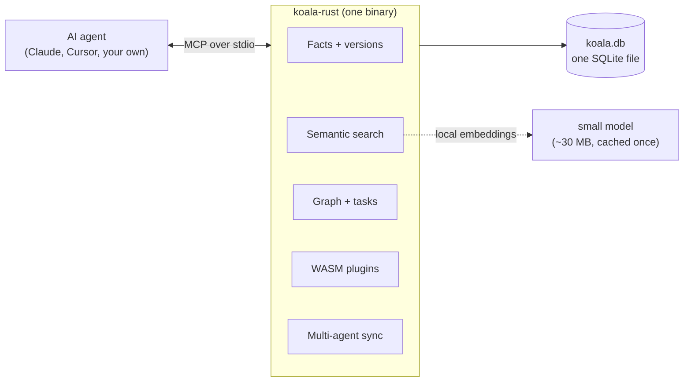

<h1 align="center">🐨 koala-rust</h1>

<p align="center">
  <b>The memory your AI agents keep.</b><br>
  One small binary. One SQLite file you own. Works with any MCP agent.
</p>

<p align="center">
  <a href="https://github.com/dbillion/koala-rust/releases/latest"></a>
  <a href="https://github.com/dbillion/koala-rust/actions/workflows/ci.yml"></a>
  <a href="LICENSE"></a>
  
  <a href="https://github.com/dbillion/koala-rust/labels/good%20first%20issue"></a>
  <a href="https://github.com/dbillion/koala-rust/labels/help%20wanted"></a>
</p>

Your agent forgets everything when the chat ends. koala-rust gives it a memory that **lasts across
sessions, understands meaning, remembers what changed, and never leaves your machine**.

```text
$ python3 examples/demo.py ./koala-rust
MCP tools: 60
stored health/cardio   1.14s     (first call loads the model)
stored finance/desk    0.00s

Q: which medicines are unsafe with blood thinners
 -> health/cardio: Patient on warfarin, avoid NSAIDs due to bleeding risk

Q: which companies can traders not touch
 -> finance/desk: Equity desk restricted list includes ACME Corp until merger closes

Process memory: 52 MB
```

The questions share no words with the stored notes. The match comes from small local embeddings.
No cloud, no API key, no language-model call.

## Why you might like it

- **Nothing to run but one binary.** No Postgres, no vector database, no account. Memory is a single SQLite file.
- **It understands meaning.** Search by what you mean, not just keywords.
- **It remembers history.** Every change to a fact is a numbered, timestamped version.
- **It plugs into your tools.** 60 MCP tools over stdio for Claude Desktop, Claude Code, Cursor and any MCP client.
- **It is small and quick.** 15 to 24 MB binary, 18 MB of RAM idle, about 10 ms to write and embed a fact.
- **It grows with you.** Knowledge graph, tasks, handoff notes between sessions, multi-agent sync and WASM plugins.

## Get started in 60 seconds

**1. Download** the binary for your system from the [latest release](https://github.com/dbillion/koala-rust/releases/latest).

| Platform | Asset |
|---|---|
| Linux x86_64 / arm64 | `koala-rust-x86_64-unknown-linux-gnu` / `koala-rust-aarch64-unknown-linux-gnu` |
| macOS Intel / Apple Silicon | `koala-rust-x86_64-apple-darwin` / `koala-rust-aarch64-apple-darwin` |
| Windows | `koala-rust-x86_64-pc-windows-msvc.exe` |

```sh
# Linux x86_64 example, with checksum check
curl -LO https://github.com/dbillion/koala-rust/releases/latest/download/koala-rust-x86_64-unknown-linux-gnu
curl -LO https://github.com/dbillion/koala-rust/releases/latest/download/SHA256SUMS.txt
sha256sum -c --ignore-missing SHA256SUMS.txt
mv koala-rust-x86_64-unknown-linux-gnu koala-rust && chmod +x koala-rust
```

**2. Add it to your agent** (any MCP client, same stanza):

```json
{ "mcpServers": { "koala": { "command": "/path/to/koala-rust", "args": ["--serve"] } } }
```

**3. Ask your agent** to "remember that we chose SQLite for storage", then ask in a new chat what you decided.

**Prefer to poke at it first?** Both examples use a throwaway folder, so your real data is untouched:

```sh
sh examples/cli_demo.sh ./koala-rust     # versioned facts from the command line
python3 examples/demo.py ./koala-rust    # semantic recall over MCP, no packages needed
```

## What you can build with it

| Idea | How koala-rust helps |
|---|---|
| **A coding agent that remembers** | Handoff notes, decisions and project status carry over between sessions (`create_handoff`, `record_decision`, `bootstrap_context`). |
| **A personal knowledge assistant** | Store notes, ask in your own words, see how a fact changed over time. |
| **A team of agents with shared memory** | Agents sync facts and a knowledge graph between machines (`sync-push`, `sync-pull`). |
| **A clinic or hospital copilot** *(pilots today, hardening in progress)* | Memory stays on the premises and recall works from meaning. See the roadmap. |
| **An analyst or advisor copilot** *(pilots today, hardening in progress)* | Local notes with exact version history and a path to point-in-time recall. See the roadmap. |
| **Edge and offline agents** *(early)* | Small footprint and no network needed once the model is cached. |

## How it works



The full architecture diagram is in the [reference guide](#architecture) below.

## How it compares

Every tool here has real strengths. This is a quick map of the trade-offs, not a ranking.
Competitor facts come from vendor pages and comparison posts (Nov 2026) and are not independently
verified. Please correct anything that is out of date.

| | koala-rust | Mem0 | Letta | Zep / Graphiti | Cognee | Dakera |
|---|---|---|---|---|---|---|
| Shape | Single binary + SQLite | Library + cloud | Full agent runtime | Temporal knowledge graph | Graph pipeline | Single Rust binary |
| License | MIT | Apache 2.0 | Apache 2.0 | Graphiti Apache 2.0, cloud closed | Apache 2.0 | MIT open-core |
| Offline | Yes, once model cached | Limited | Yes | Library, needs graph DB | Yes | Yes |
| Extra services | None | Vector DB (self-host) | Postgres or SQLite | Neo4j, FalkorDB or Neptune | Optional DBs | None |
| Write path | Local embedding only | LLM extraction per add | LLM tool calls | Graph extraction | LLM pipeline | Local embedding |
| Footprint | 15 to 24 MB, 18 to 52 MB RAM | n/s | n/s | n/s | n/s | about 101 MB binary |
| Managed price | Free | $19 to $249 / mo | $20 / mo + usage | $125 to $375 / mo | usage based | no cloud |

`n/s` = not stated by the sources we found. koala-rust numbers were measured on the v0.3.3 Linux
x86_64 release binary: 18 MB idle, 52 MB after the model loads, about 30 MB one-time model download,
10 ms write plus embed, 20 to 40 ms recall on a small store. Large-store benchmarks are
[an open task](https://github.com/dbillion/koala-rust/issues/37).

<details>
<summary><b>Footprint measurements</b> (v0.3.3, Linux x86_64, Nov 2026)</summary>

| Item | Measured |
|---|---|
| Binary | 14.9 MB (macOS arm64), 16.3 MB (Windows), 21.5 MB (Linux arm64), 24.4 MB (Linux x86_64) |
| Memory, server idle / after model load | 18 MB / 52 MB |
| Embedding model (one-time download) | about 30 MB (`potion-base-8M`, 256 dimensions) |
| Database with 3 facts and vector tables | about 1.2 MB |
| Write plus embed / semantic recall (small store) | about 10 ms / 20 to 40 ms |
| Needs network after the model is cached | No (checked by running the demo under `unshare -n`) |
</details>

<details>
<summary><b>What it is worth in money</b></summary>

The direct saving today is software fees you stop paying. Managed memory list prices per workspace
(Nov 2026 research, verify before relying on them): Mem0 $228 to $2,988 a year, Zep $1,500 to $4,500,
Letta about $240. koala-rust is MIT licensed, so you pay only for your own machine. Tools that call a
language model on every write also add a token cost per write, which koala-rust does not.
The bigger prize, memory for regulated teams, depends on the roadmap below. Compliance
(SOC 2, HIPAA) is about organisations and process, not a binary, and this project does not
reduce that cost. Not legal advice.
</details>

## Where it is today, and where it is going

The next goal is to make koala-rust trustworthy for sensitive work in **healthcare and finance**
first, with **defense** and air-gapped edge use after that. Every step is an open issue you can
pick up, and each has a clear "done when".

| Theme | What is coming | Start here |
|---|---|---|
| **Forget for real** | Delete every version of a fact, its vectors and its bytes; retention rules | [#11](https://github.com/dbillion/koala-rust/issues/11) · [#12](https://github.com/dbillion/koala-rust/issues/12) |
| **Know what it knew** | Point-in-time recall (`--as-of`), tamper-evident audit log | [#13](https://github.com/dbillion/koala-rust/issues/13) · [#15](https://github.com/dbillion/koala-rust/issues/15) |
| **Protect the data** | Encryption at rest, access labels and tenant namespaces | [#14](https://github.com/dbillion/koala-rust/issues/14) · [#16](https://github.com/dbillion/koala-rust/issues/16) |
| **Trust the plugins** | Required checksums, signatures, sandbox limits, native plugins off by default | [#17](https://github.com/dbillion/koala-rust/issues/17) · [#29](https://github.com/dbillion/koala-rust/issues/29) |
| **Run anywhere** | True offline build, safe migrations and backup | [#18](https://github.com/dbillion/koala-rust/issues/18) · [#20](https://github.com/dbillion/koala-rust/issues/20) |
| **Easy to adopt** | CLI recall, Python adapters, tested setup for every MCP client, demo recording | [#22](https://github.com/dbillion/koala-rust/issues/22) · [#23](https://github.com/dbillion/koala-rust/issues/23) · [#35](https://github.com/dbillion/koala-rust/issues/35) · [#34](https://github.com/dbillion/koala-rust/issues/34) |
| **Healthy codebase** | Split big files into small modules, more tests, benchmarks | [#19](https://github.com/dbillion/koala-rust/issues/19) · [#21](https://github.com/dbillion/koala-rust/issues/21) · [#37](https://github.com/dbillion/koala-rust/issues/37) |
| **Sector guides** | Healthcare, finance, then defense deployment notes | [#25](https://github.com/dbillion/koala-rust/issues/25) · [#26](https://github.com/dbillion/koala-rust/issues/26) · [#27](https://github.com/dbillion/koala-rust/issues/27) |

Details by sector are below.

<details>
<summary><b>Readiness by sector (healthcare, finance, defense last)</b></summary>

| Capability | Today | Tracking |
|---|---|---|
| Runs on your machine, no cloud | Works (model cached once) | [#18](https://github.com/dbillion/koala-rust/issues/18) |
| Semantic recall, version history | Works | |
| Verified deletion of all versions | Not yet | [#11](https://github.com/dbillion/koala-rust/issues/11) |
| Retention (TTL), point-in-time recall | Not yet | [#12](https://github.com/dbillion/koala-rust/issues/12), [#13](https://github.com/dbillion/koala-rust/issues/13) |
| Encryption at rest, tamper-evident audit, access control | Not yet | [#14](https://github.com/dbillion/koala-rust/issues/14), [#15](https://github.com/dbillion/koala-rust/issues/15), [#16](https://github.com/dbillion/koala-rust/issues/16) |
| HIPAA, SOC 2, FedRAMP, CMMC | None. These apply to organisations, not binaries | [#24](https://github.com/dbillion/koala-rust/issues/24) |

**Healthcare.** Data never leaves the machine and recall works from meaning, which suits clinic
copilots. Use de-identified or synthetic data until delete, retention, encryption, audit and access
labels land. Whether you need a business associate agreement depends on who hosts it; ask a
health-privacy lawyer. Guide: [#25](https://github.com/dbillion/koala-rust/issues/25).

**Finance.** Local data and exact version history suit analyst and advisor notes. Keep material
non-public information out until namespaces, point-in-time recall and the audit chain exist. A hash
chain alone is not SEC 17a-4 or WORM compliance. Guide: [#26](https://github.com/dbillion/koala-rust/issues/26).

**Defense and intelligence (last).** The offline story is partly there. Buyers also expect
FIPS-validated cryptography, TPM or HSM keys, SBOMs, accreditation and certified hardware. Realistic
route: small embedded memory for edge devices through hardware partners, after the work above.
Track: [#27](https://github.com/dbillion/koala-rust/issues/27).
</details>

## Contribute

New here? You are exactly who this project wants. We like first pull requests and we help you land them.

1. **Pick a task:** browse [good first issues](https://github.com/dbillion/koala-rust/labels/good%20first%20issue)
   or [help wanted](https://github.com/dbillion/koala-rust/labels/help%20wanted). Comment to say you are on it.
2. **Set up in five minutes:** `git clone`, `cargo build`, `cargo test`. Steps and checks are in
   [CONTRIBUTING.md](CONTRIBUTING.md).
3. **Open a pull request.** Small and focused is great.

Ideas that need no Rust: record the README demo ([#34](https://github.com/dbillion/koala-rust/issues/34)),
test setup on your MCP client ([#35](https://github.com/dbillion/koala-rust/issues/35)), try the examples on macOS or
Windows ([#36](https://github.com/dbillion/koala-rust/issues/36)), improve docs, or write an example in your favourite language
([#38](https://github.com/dbillion/koala-rust/issues/38)).

Found a bug or have an idea? [Open an issue](https://github.com/dbillion/koala-rust/issues/new/choose).
Security problem? See [SECURITY.md](SECURITY.md). Everyone follows the [Code of Conduct](CODE_OF_CONDUCT.md).

<a href="https://github.com/dbillion/koala-rust/graphs/contributors">
  
</a>

## License

MIT. See [LICENSE](LICENSE).

---

# Reference guide

The original README content, kept in full. Where v0.3.3 behaves differently, the text is corrected or a **Reality check** note is added.

## ✨ Features

| Feature | Description |
|---------|-------------|
| **Persistent Facts** | Versioned key-value storage with SQLite |
| **Semantic Search** | Exact KNN vector search via `sqlite-vec` (256-dim embeddings) |
| **Real Embeddings** | Local Model2Vec + `potion-base-8M` (256-dim, ~30 MB, downloads from Hugging Face once on first use) |
| **Knowledge Graph** | Entities, observations, relations with graph traversal |
| **Task Management** | Structured tasks/notes with queries and updates |
| **CRDT Sync** | Vector clocks + last-write-wins for multi-agent collaboration |
| **WASM Plugins** | Sandboxed plugins (wasmtime) + native plugins (libloading) |
| **Plugin Marketplace** | Install plugins. SHA256 checksum is checked when the registry lists one. No signatures yet ([#17](https://github.com/dbillion/koala-rust/issues/17)) |
| **MCP Server** | 60 tools via stdio — works with Claude, Hermes, any MCP client |

---

<a id="architecture"></a>

## 🏛️ Architecture Overview


---

## 🚀 Quick Start

### Install (Self-contained release bundle)

Choose the archive matching your platform from [GitHub Releases](https://github.com/dbillion/koala-rust/releases). Each archive contains the Koala executable and its matching `sqlite-vec` loadable extension (`vec0.so`, `vec0.dylib`, or `vec0.dll`). **v0.3.3 and earlier do not include these bundles**; for those versions, install a compatible extension separately and set `KOALA_VEC0_PATH`.

| Platform | Release archive |
|---|---|
| Linux x86_64 | `koala-rust-x86_64-unknown-linux-gnu.tar.gz` |
| Linux ARM64 | `koala-rust-aarch64-unknown-linux-gnu.tar.gz` |
| macOS Intel | `koala-rust-x86_64-apple-darwin.tar.gz` |
| macOS Apple Silicon | `koala-rust-aarch64-apple-darwin.tar.gz` |
| Windows x86_64 | `koala-rust-x86_64-pc-windows-msvc.tar.gz` |

Example for Linux x86_64:

```bash
curl -fL https://github.com/dbillion/koala-rust/releases/latest/download/koala-rust-x86_64-unknown-linux-gnu.tar.gz -o koala-rust.tar.gz
curl -fL https://github.com/dbillion/koala-rust/releases/latest/download/SHA256SUMS.txt -o SHA256SUMS.txt
sha256sum -c --ignore-missing SHA256SUMS.txt
tar -xzf koala-rust.tar.gz
chmod +x koala-rust
./koala-rust --serve
```

Keep the executable and its adjacent `vec0.*` library together. For source/Cargo installs, install a compatible sqlite-vec extension separately and set `KOALA_VEC0_PATH` to its full path:

```bash
cargo install --git https://github.com/dbillion/koala-rust
```

### Run MCP Server

```bash
# Set state directory (where SQLite + embeddings live)
export KOALA_STATE_DIR=~/.koala

# Start MCP server (stdio)
./koala-rust --serve
```

### Use with Any MCP Client

**Claude Desktop** (`claude_desktop_config.json`):
```json
{
  "mcpServers": {
    "koala": {
      "command": "/full/path/to/koala-rust",
      "args": ["--serve"],
      "env": { "KOALA_STATE_DIR": "/home/you/.koala" }
    }
  }
}
```

**Hermes** (`~/.hermes/config.yaml`):
```yaml
mcp_servers:
  koala-rust:
    command: "/full/path/to/koala-rust"
    args: ["--serve"]
    env:
      KOALA_STATE_DIR: "/home/you/.koala"
    enabled: true
```

**Custom Client** — connect via stdio JSON-RPC 2.0.

---

## 🎯 10 Key Business Use Cases

| # | Use Case | Value |
|---|----------|-------|
| **1** | **Institutional Knowledge Retention** | Never lose technical decisions, debugging context, or tribal knowledge when team members leave. Semantic search finds "why we chose X" instantly. |
| **2** | **Multi-Agent Collaboration** | Research, coding, and review agents share a synchronized fact base via CRDT — no conflicting states, no manual handoffs. |
| **3** | **Compliance & Audit Trail** | Versioned facts + timestamps = immutable record of decisions. Export for SOC2, GDPR, or internal audits. |
| **4** | **Cross-Session Continuity** | Agents resume exactly where they left off — context, tasks, learned patterns persist across restarts, days, machines. |
| **5** | **Private AI Memory (Air-Gapped)** | 100% local, no API keys, no cloud. Runs in secure environments, regulated industries, offline deployments. |
| **6** | **Plugin-Driven Workflow Automation** | Install WASM plugins for custom transformers (hash, JSON, text, domain-specific). Extend without recompiling. |
| **7** | **Semantic Search over Conversations** | "What did we decide about auth last month?" → vector search returns relevant turns, not keyword matches. |
| **8** | **Knowledge Graph for Domain Modeling** | Entities + observations + relations = queryable domain model. "Show all services depending on PostgreSQL." |
| **9** | **Task Handoff Between Agents** | Structured tasks with state, priority, assignee. Agent A creates, Agent B picks up, Agent C reviews — all tracked. |
| **10** | **Embedding-Powered RAG Without Cloud** | Local embeddings + vector search = full RAG pipeline on-device. Zero marginal cost per query. |

> **Reality check (v0.3.3)** for use cases 3 and 5.
> - **#3 Compliance & audit trail.** Versions and timestamps are a history, not an immutable record. Rows can be edited, and `fact-delete` leaves old versions and bytes on disk ([#11](https://github.com/dbillion/koala-rust/issues/11)). There is no hash chain or signature yet ([#15](https://github.com/dbillion/koala-rust/issues/15)). Do not present it to an auditor as tamper-evident. Nothing here is certified for SOC 2 or HIPAA.
> - **#5 Air-gapped.** Works offline once the embedding model is cached. The first run downloads it, and plugin registry commands fetch from GitHub ([#18](https://github.com/dbillion/koala-rust/issues/18)). The database file is not encrypted ([#14](https://github.com/dbillion/koala-rust/issues/14)).

---

## 🛠️ CLI Usage

```bash
# Health check
koala-rust health

# Facts
koala-rust fact-write --name "project:config" --text "Uses port 8080"
koala-rust fact-read --name "project:config"
koala-rust fact-list
koala-rust fact-versions --name "project:config" --limit 5

# Entities & Knowledge Graph
koala-rust entity-create --name "User" --type "person" --observations "Prefers TypeScript"
koala-rust entity-search --query "User"
koala-rust entity-create --name "Project" --type "project"
koala-rust relation-create --from "User" --to "Project" --type "owns"

# Tasks
koala-rust task-create --title "Review PR #42" --body "Check vector search logic"
koala-rust task-query --status pending

# Embeddings & Vector Search
koala-rust embed-text --text "How to configure vector search"
koala-rust vector-upsert-fact --fact-id 1 --embedding "0.1,0.2,..."   # comma list; see #22
koala-rust vector-search-facts --query-embedding "0.1,0.2,..." --k 5

# Sync (Multi-agent)
koala-rust sync-status
koala-rust sync-push
koala-rust sync-pull
# sync_write_fact, sync_get_changes and sync_merge_changes are MCP tools

# Plugins
# plugin_list is an MCP tool; the CLI has plugin-search / install / uninstall / call
koala-rust plugin-search --query "hash"
koala-rust plugin-install --name hash-tools
# Flags are --plugin --tool --args. This hash-tools example currently fails in v0.3.3, see #29
koala-rust plugin-call --plugin hash-tools --tool sha256 --args '{"input":"hello"}'

# Continuity (handoff notes, decisions, project status)
koala-rust context bootstrap --project myproject
koala-rust context checkpoint --help
koala-rust context decision --help
koala-rust context status --help
```

> Commands above were checked against `koala-rust --help` of v0.3.3. Semantic recall (`recall`, `remember_semantic`) is MCP-only for now ([#22](https://github.com/dbillion/koala-rust/issues/22)).


---

## 🔌 MCP Tools (60 Total)

| Category | Tools |
|----------|-------|
| **Health** | `health` |
| **Facts** | `write_fact`, `read_fact`, `list_facts`, `read_fact_versions`, `delete_fact`, `delete_fact_prefix` |
| **Entities** | `create_entities`, `add_observations`, `open_nodes`, `search_nodes`, `create_relations` |
| **Tasks** | `create_task_or_note`, `query_tasks`, `update_task` |
| **Neural Model** | `model_init`, `model_train`, `model_predict`, `model_status`, `feedback`, `explain_rank`, `sequential_thinking`, `conclusion`, `thought_history`, `thought_reset`, `model_save`, `model_load` |
| **Vector Search** | `vector_upsert_fact`, `vector_upsert_entity`, `vector_search_facts`, `vector_search_entities`, `vector_delete_fact`, `vector_delete_entity` |
| **Sync (CRDT)** | `sync_write_fact`, `sync_read_fact`, `sync_list_facts`, `sync_create_entity`, `sync_get_changes`, `sync_merge_changes` |
| **Semantic memory** | `remember_semantic`, `recall`, `reindex_facts` |
| **Continuity** | `bootstrap_context`, `create_handoff`, `get_project_context`, `get_user_context`, `record_decision`, `search_memory`, `update_project_status` |
| **Embeddings** | `embed_text`, `embed_batch` |
| **Plugins** | `plugin_load`, `plugin_call`, `plugin_list`, `plugin_discover` |
| **Marketplace** | `plugin_search`, `plugin_install`, `plugin_uninstall`, `plugin_registry_stats`, `plugin_update_registry` |

---

## 📚 koala-mcp Skill (Usage Guide)

A dedicated skill teaches agents how to use koala-rust effectively via MCP. **Included in this repo at `skills/koala-mcp/`.**

### Install Skill

```bash
# Hermes (from local repo)
hermes skill install skills/koala-mcp

# Or clone skill dir directly
cp -r skills/koala-mcp ~/.hermes/skills/koala-mcp
```

### Skill Provides

| Capability | Description |
|------------|-------------|
| **Tool Reference** | All 50 MCP tools with parameters, examples, error handling |
| **Workflow Patterns** | Common patterns: fact extraction → embed → upsert → search |
| **Best Practices** | When to use facts vs entities vs tasks, naming conventions |
| **Integration Recipes** | Claude Desktop, Hermes, custom MCP clients |
| **Troubleshooting** | Common errors, performance tuning, debugging tips |

### Example Skill Usage (Agent)

```
# Agent reads skill, then:
koala_recall("authentication architecture decision")
# → Returns relevant facts with scores

koala_write_fact("api:rate_limit", "100 req/min per IP")
# → Stores with auto-embedding for future recall
```

---

## 🧠 Auto-Conversation Memory (Hermes)

The **koala-memory** Hermes plugin captures every conversation turn, extracts facts, generates embeddings, and enables semantic recall.

### Install Plugin

```bash
# Copy to Hermes user plugins dir
cp -r koala-memory ~/.hermes/plugins/koala-memory
```

### Enable in Config

```yaml
# ~/.hermes/config.yaml
plugins:
  enabled:
    - koala-memory
    # ... other plugins

memory:
  provider: koala   # <-- Critical: only ONE external provider allowed
```

### Restart Gateway

```bash
systemctl --user restart hermes-gateway
```

### Agent Tools Available

After restart, agents get 3 tools:

| Tool | Description |
|------|-------------|
| `koala_recall` | Search conversation memory by semantic similarity |
| `koala_write_fact` | Manually write a fact to persistent memory |
| `koala_search` | Alias for recall |

**How it works:**
1. `on_turn_start` → captures user messages
2. `on_session_end` → extracts facts, embeds via `embed_text`, stores via `write_fact`, upserts vectors via `vector_upsert_fact`
3. Background thread → non-blocking async processing
4. `koala_recall("vector search config")` → returns relevant past conversations

---

## 🏗️ Build from Source

### Prerequisites

- Rust 1.91+ (MSRV)
- `sqlite3` dev headers
- `pkg-config`

### Build

```bash
git clone https://github.com/dbillion/koala-rust
cd koala-rust

# Type-check only (fast)
cargo check

# Lint
cargo clippy

# Release build (~8-10 min first time)
cargo build --release

# Binary at target/release/koala-rust
```

### Cross-Platform Builds (Local)

```bash
# Install cross
cargo install cross

# Linux x86_64
cross build --release --target x86_64-unknown-linux-gnu

# Linux ARM64
cross build --release --target aarch64-unknown-linux-gnu

# macOS x86_64
cargo build --release --target x86_64-apple-darwin  # run on macOS

# macOS ARM64 (Apple Silicon)
cargo build --release --target aarch64-apple-darwin  # run on macOS

# Windows x86_64 (run on Windows with MSVC build tools installed)
cargo build --release --target x86_64-pc-windows-msvc
```

### GitHub Actions (Auto on Tag)

The repo includes **two workflows** in `.github/workflows/`:

| Workflow | Trigger | Purpose |
|----------|---------|---------|
| `ci.yml` | Push/PR to master | Format, clippy, type-check, test, cross-platform check (5 targets) |
| `release.yml` | Tag push (`v*`) | **Build 5 platform binaries + create GitHub Release** |

**Release on tag push:**
```bash
git tag v0.3.0
git push origin v0.3.0
# → CI passes → release.yml builds all 5 targets → creates GitHub Release with binaries
```

**Artifacts produced per release:**
| Platform | Artifact Name |
|----------|---------------|
| Linux x86_64 | `koala-rust-x86_64-unknown-linux-gnu` |
| Linux ARM64 | `koala-rust-aarch64-unknown-linux-gnu` |
| macOS x86_64 (Intel) | `koala-rust-x86_64-apple-darwin` |
| macOS ARM64 (Apple Silicon) | `koala-rust-aarch64-apple-darwin` |
| Windows x86_64 | `koala-rust-x86_64-pc-windows-msvc.exe` |

Each release includes `SHA256SUMS.txt` for verification.

---

## 📦 Plugin Development

### WASM Plugin (Recommended)

Create a WAT file with required exports:

```wat
(module
  (memory 1 10)  ;; 10 pages = 640 KB
  (export "memory" (memory 0))

  ;; Allocator for host→WASM data transfer
  (func (export "allocate") (param $size i32) (result i32)
    ;; Return pointer to fresh memory
  )
  (func (export "deallocate") (param $ptr i32) (param $size i32)
    ;; Free memory
  )

  ;; Manifest & tools (called by host after allocate+write)
  (func (export "set_manifest") (param $ptr i32) (param $len i32))
  (func (export "set_tools") (param $ptr i32) (param $len i32))
  (func (export "get_manifest") (result i32))
  (func (export "get_tools") (result i32))

  ;; Tool execution
  (func (export "call_tool") (param $name_ptr i32) (param $name_len i32)
                    (param $input_ptr i32) (param $input_len i32)
                    (result i32))
)
```

**Host calls:** `allocate()` → writes JSON → `set_manifest(ptr, len)` / `set_tools(ptr, len)` → `get_manifest()` / `get_tools()` → `call_tool()`.

See `plugins/wasm/*.wat` for examples: `hash-tools`, `text-transform`, `json-tools`.

### Native Plugin

Shared library with C ABI:

```c
// plugin.h
typedef struct { const char* name; const char* version; } PluginManifest;
typedef struct { const char* name; const char* description; const char* input_schema; } ToolDef;

PluginManifest* get_manifest();
ToolDef* get_tools(int* count);
char* call_tool(const char* tool_name, const char* input_json);
void free_string(char* s);
```

Compile: `rustc --crate-type=cdylib plugin.rs -o libplugin.so`

Install: `koala-rust plugin-install --path ./libplugin.so --type native`

---

## 🔒 Privacy & Security

- **100% local** — no network calls except initial model download (~30 MB potion-base-8M from HuggingFace)
  - Checked in the v0.3.3 source: HTTP is used only by the model download and the plugin marketplace (registry on GitHub). No telemetry code found. Offline build: [#18](https://github.com/dbillion/koala-rust/issues/18).
- **WASM sandbox** — memory-limited, no host access
  - A `max_memory_mb` setting exists but is not enforced anywhere in the code, and there are no fuel or time limits yet ([#17](https://github.com/dbillion/koala-rust/issues/17)).
- **Native plugins** — only from trusted sources (you verify)
  - Native plugins are shared libraries with full host access, outside the sandbox. Planned to be off by default ([#17](https://github.com/dbillion/koala-rust/issues/17)).
- **SQLite** — single file, easy to backup/encrypt
  - koala-rust does not encrypt the file itself ([#14](https://github.com/dbillion/koala-rust/issues/14)). Use full-disk encryption for now.
- **No telemetry** — zero data leaves your machine

---

## 📊 Performance

| Operation | Latency (typical) |
|-----------|-------------------|
| Fact write/read | < 1 ms |
| Embedding (256-dim) | ~50 ms (CPU) |
| Vector upsert | < 5 ms |
| Vector search (k=10) | < 10 ms |
| Sync merge (1000 ops) | ~100 ms |
| Plugin call (WASM) | ~1 ms overhead |

> These are the author's typical figures, not from a benchmark suite. Measured on the v0.3.3 Linux x86_64 binary: first embedding call about 1.1 s (model load), then write plus embed about 10 ms, recall on a small store 20 to 40 ms. Large-store benchmarks are still to do.

---

## 🗺️ Roadmap

| Version | Focus |
|---------|-------|
| **v0.3** | Conversation auto-logging hook, better fact extraction (LLM-based) |
| **v0.4** | Remote plugin registry, plugin signing/verification |
| **v0.5** | Distributed sync (WebRTC/WebSocket), conflict resolution UI |
| **v1.0** | Production hardening, benchmarks, migration tools |

> v0.3.3 added the continuity tools (handoff, decisions, project status). Current, detailed work items live in the issues: [#11 to #29](https://github.com/dbillion/koala-rust/issues).

---

## 🤝 Contributing

```bash
# 1. Fork & clone
# 2. Create branch
# 3. Make changes + tests
# 4. cargo check && cargo clippy && cargo test
# 5. PR with conventional commit: "feat: add X" / "fix: resolve Y"
```

---

## 📄 License

MIT — see [LICENSE](LICENSE)

---

## 🔗 Related

- **Hermes Plugin**: `koala-memory` (in `~/.hermes/plugins/koala-memory/`)
- **koala-mcp Skill**: `skills/koala-mcp/` in this repo
- **MCP Spec**: https://modelcontextprotocol.io
- **sqlite-vec**: https://github.com/asg017/sqlite-vec
- **Model2Vec**: https://github.com/MinishLab/model2vec-rs
- **wasmtime**: https://github.com/bytecodealliance/wasmtime